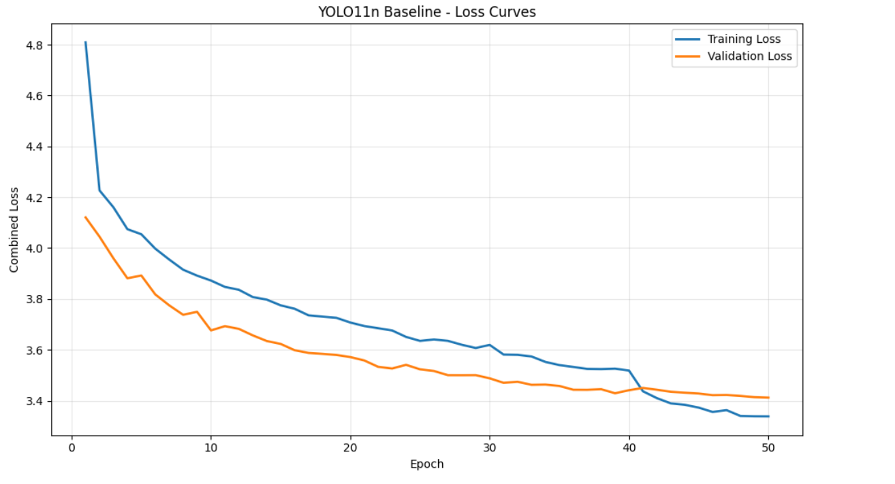
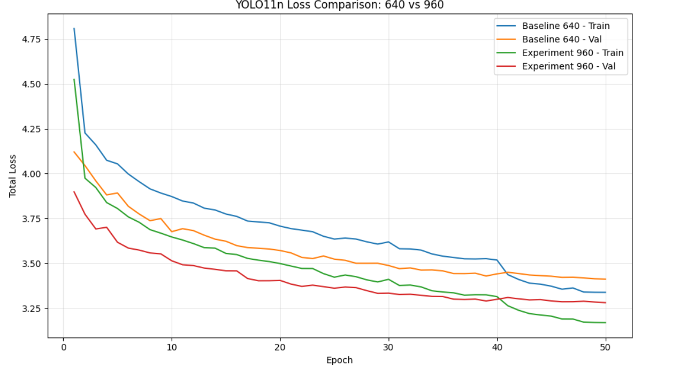

# CMPE401-Project1-YOLO11
<h2 align="center"><strong>1. Introduction</strong></h2>

Object detection is an important application of deep learning and computer vision, widely used in autonomous driving, intelligent transportation, robotics, and surveillance systems.

This project investigates the performance of YOLO11 on the VisDrone2019-DET dataset, which contains aerial images with small objects, dense scenes, and complex backgrounds.

The project focuses on training a baseline model, analyzing training behavior, conducting controlled experiments, and evaluating whether changes in image resolution improve object detection performance.

<h2 align="center"><strong>2. Model and data </strong></h2>
This project uses YOLO11n, a lightweight object detection model developed by Ultralytics. It provides efficient object detection with relatively low computational requirements.

The model was initialized with pretrained weights (yolo11n.pt) and fine-tuned on the VisDrone dataset.

Two configurations were tested:

Baseline: Image size 640 × 640.

Experiment: Image size 960 × 960.

Both models were trained for 50 epochs with a batch size of 8.
This project uses the VisDrone2019-DET dataset recommended by the course instructor. The dataset contains aerial images of pedestrians, vehicles, and other objects captured by drones.

It presents challenges such as small objects, crowded scenes, and complex backgrounds.

The dataset contains 10 object categories and was prepared for YOLO11 training by converting the original annotations into YOLO format.

Training 6,471

Validation 548

Total 7,019
<h2 align="center"><strong>3. Useage </strong></h2>

This project was developed and executed using Google Colab with GPU acceleration and the Ultralytics YOLO11 framework.

To reproduce the experiments, download the project files from the Google Drive link below and open the provided Jupyter Notebook (.ipynb) in Google Colab.

Install the required dependencies using `pip install ultralytics`, mount Google Drive, and configure the dataset path in `visdrone.yaml`.

Run the notebook cells in order to prepare the dataset, train the baseline YOLO11n model at 640 × 640 resolution, and conduct the controlled experiment at 960 × 960 resolution. Both models were trained for 50 epochs with a batch size of 8 and a random seed of 42.

The training results, loss curves, and trained model weights are saved in the project folders. The fine-tuned model weights can be used for further evaluation without retraining.

[Access Project Files and Trained Models](https://drive.google.com/drive/folders/1aAr7dT9nYkOKcM4v2ceVUxIML5VaRscT?usp=drive_link)

For users who only want to view the experimental results without downloading the complete project, the results can be accessed directly through the result-source branch of the GitHub repository.

[View Experimental Results (result-source branch)](https://github.com/jianqiaopeng8-afk/CMPE401-Project1-YOLO11/tree/result-source)

<h2 align="center"><strong>4. Baseline Model </strong></h2>

The baseline model uses YOLO11n with pretrained weights (`yolo11n.pt`) and is fine-tuned on the VisDrone2019-DET dataset.

The model was trained using an input image resolution of 640 × 640 with 50 epochs, a batch size of 8, and a random seed of 42. Training was performed on Google Colab using GPU acceleration.

The purpose of the baseline model is to establish a reference for evaluating subsequent model improvements.

At Epoch 50, the baseline model achieved an mAP of 0.1733 (17.33%), a Precision of 0.4420 (44.20%), and a Recall of 0.3222 (32.22%).

These results provide a reference for evaluating whether increasing the input image resolution improves object detection performance.

  

  Figure 1. Baseline Model Training Results

<h2 align="center">5. Loss Curve and Fitting Analysis</h2>

The baseline YOLO11n model showed stable convergence over 50 epochs. The training loss decreased from approximately 4.8 to 3.34, while the validation loss decreased from 4.12 to 3.41. Both curves gradually flattened, indicating that the model was approaching convergence.

No significant overfitting was observed because the validation loss continued to decrease without a sustained upward trend. However, the relatively low mAP of 0.1733, Precision of 0.4420, and Recall of 0.3222 suggest that the model's detection capability remains limited, although the loss curves alone do not confirm severe underfitting.

This may be related to the complexity of the VisDrone dataset, which contains 7,019 images, including 6,471 training images and 548 validation images. The dataset contains many small and densely distributed objects, making detection more challenging. Additionally, YOLO11n is a lightweight model with limited capacity, which may restrict its ability to learn complex visual features.

Overall, the baseline model demonstrated stable convergence without obvious overfitting, but its detection performance indicates that further improvements are needed.

<h2 align="center">6. Structured Experimental Design</h2>

A controlled experiment was conducted to investigate the effect of input image resolution on YOLO11n object detection performance using the VisDrone2019-DET dataset.

The baseline model was trained at an image resolution of 640 × 640, while the experimental model used 960 × 960. Both models used the same YOLO11n architecture, pretrained weights, dataset, 50 training epochs, batch size of 8, and random seed of 42. Input image resolution was the primary variable changed in this experiment.

The purpose of increasing the image resolution was to preserve more visual details of small objects in aerial images, potentially improving detection performance.

At Epoch 50, the baseline model achieved a Precision of 0.4420, Recall of 0.3222, and mAP50-95 of 0.1733. The experimental model achieved a Precision of 0.5187, Recall of 0.4025, and mAP50-95 of 0.2406.

Compared with the baseline, Precision increased by approximately 0.0768, Recall increased by 0.0803, and mAP50-95 increased by 0.0673. The relative improvement in mAP50-95 was approximately 38.8%.

<h2 align="center">7. Iterative Model Improvement</h2>

7.1 Baseline Model

The baseline YOLO11n model was trained on the VisDrone2019-DET dataset using an input image resolution of 640 × 640.

After 50 training epochs, the baseline model achieved a Precision of 0.4420, Recall of 0.3222, and mAP50-95 of 0.1733.

These results indicated that the baseline model had room for improvement in detecting objects in aerial images.

7.2 Experimental Settings

An improvement experiment was conducted to investigate whether increasing input image resolution could improve detection performance.

The baseline and improved models used the same YOLO11n architecture, pretrained weights, dataset, 50 training epochs, batch size of 8, and random seed of 42.

Input image resolution was selected as the primary variable for modification.

7.3 Controlled Modification

The input image resolution was increased from 640 × 640 to 960 × 960.

This modification was motivated by CNN feature extraction principles. The VisDrone dataset contains many small and densely distributed objects, which may lose important spatial information when images are resized to lower resolutions.

Using higher-resolution images may preserve more details of small objects and help the CNN extract more useful features for object detection.

All other listed experimental settings were kept consistent to isolate the effect of input resolution.

7.4 Quantitative Comparison

The following table compares the detection performance of the baseline and improved models after 50 training epochs.

| Metric | Baseline (640 × 640) | Improved (960 × 960) |
|---|---:|---:|
| Precision | 0.4420 | 0.5187 |
| Recall | 0.3222 | 0.4025 |
| mAP50-95 | 0.1733 | 0.2406 |

The improved model achieved higher values across all three evaluation metrics.

Precision increased by approximately 0.0767, Recall increased by 0.0803, and mAP50-95 increased by 0.0673.

The relative improvement in mAP50-95 was approximately 38.8%.

7.5 Performance Discussion

The experimental results indicate that increasing the input image resolution improved the detection performance of YOLO11n under the tested conditions.

The higher Precision suggests that a greater proportion of predicted detections were correct, while the higher Recall indicates that more ground-truth objects were successfully detected.

The increase in mAP50-95 demonstrates improved overall detection performance across multiple IoU thresholds.

A possible explanation is that higher-resolution images preserved additional spatial details, allowing the model to extract more informative features from small objects.

However, increasing image resolution may also increase GPU memory usage and computational cost.

Therefore, the improvement in detection performance should be considered alongside the additional computational requirements.

  

7.6 Conclusion

This improvement cycle followed the process of baseline evaluation, experimental setup, controlled modification, performance evaluation, analysis, and conclusion.

Increasing the input resolution from 640 × 640 to 960 × 960 improved Precision, Recall, and mAP50-95 on the VisDrone2019-DET dataset.

The mAP50-95 increased by approximately 38.8% relative to the baseline, demonstrating that higher input resolution was an effective modification under the tested conditions.

This experiment highlights the importance of preserving spatial information during CNN feature extraction, particularly when detecting small objects in aerial images.

These results suggest that increasing the input image resolution from 640 × 640 to 960 × 960 improved detection performance on the VisDrone dataset. The higher resolution may help the model preserve more information about small objects, although it also requires greater computational resources.

Overall, the controlled experiment demonstrates that input image resolution is an important factor affecting YOLO11n detection performance, particularly for aerial images containing small and densely distributed objects.

<h2 align="center">8. Overall Conclusion</h2>

This project investigated the performance of YOLO11n for object detection on the VisDrone2019-DET dataset, with a focus on detecting small objects in aerial images.

A baseline YOLO11n model was trained using an input resolution of 640 × 640 for 50 epochs. The training and validation loss curves showed a gradual decrease and stabilization, indicating that the model was learning and approaching convergence without clear evidence of severe overfitting.

A controlled experiment was then conducted by increasing the input resolution from 640 × 640 to 960 × 960 while keeping the other experimental settings consistent.

The experimental model achieved a Precision of 0.5187, Recall of 0.4025, and mAP50-95 of 0.2406, compared with the baseline values of 0.4420, 0.3222, and 0.1733, respectively. The relative improvement in mAP50-95 was approximately 38.8%.

The loss comparison further demonstrated that the higher-resolution model achieved lower training and validation losses by the end of training. These results suggest that increasing input resolution can improve feature extraction and detection performance, particularly for aerial images containing small objects.

However, the overall detection accuracy remains limited, and higher input resolutions may require additional computational resources. Future improvements could include experimenting with larger YOLO models, data augmentation, learning rate scheduling, and additional training configurations.

Overall, this project demonstrated the importance of controlled experimentation, loss curve analysis, and iterative model improvement in deep learning. The results showed that input image resolution is an important factor affecting YOLO11n detection performance on the VisDrone2019-DET dataset.
